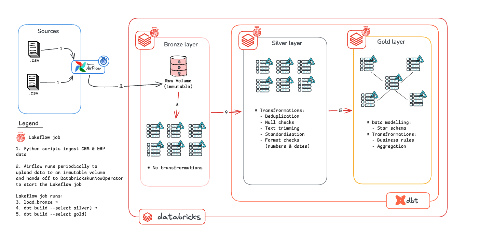

# Lakehouse Project (Databricks)

This project rebuilds the [SQL Server data warehouse](https://github.com/nasser-kiti/warehouse-project-local) as a lakehouse on Databricks, using the Medallion Architecture. Airflow lands source files in an immutable volume, and a Lakeflow job loads them into Bronze and runs the dbt transformations for Silver and Gold.

- **Data Architecture**: a lakehouse on **Databricks** and Unity Catalog, organised into landing, Bronze, Silver and Gold layers.
- **Ingestion**: write-once, checksum-verified landing of source files, orchestrated by **Airflow**.
- **ELT**: raw data is loaded first, then transformed in the platform with **dbt**.
- **Orchestration**: Airflow handles getting data into the platform; a **Lakeflow** job (defined as code with Databricks Asset Bundles) runs everything inside it.
- **Data Quality**: integrity checks before Bronze, and dbt tests that gate each layer.

### Specifications

- **Data Sources**: two source systems (CRM and ERP) delivered as CSV files.
- **Raw data is never changed**: landed files are immutable; corrections arrive as new batches.
- **Reruns are safe**: every stage is idempotent, so retries and backfills never duplicate data.
- **Data Quality**: data quality issues are resolved in Silver, and tests stop bad data from reaching Gold.
- **Scope**: latest-state analytics; historisation is not required.


## Data Architecture



1. **Landing**: an Airflow task uploads the CSV files to a Unity Catalog volume, one write-once folder per source per ingest date, with a checksum manifest written last.
2. **Hand-off**: Airflow triggers the Lakeflow job by name, passing the ingest date, and waits for it to finish.
3. **Bronze**: the job verifies each manifest, then loads the files into Delta tables with `COPY INTO`, unchanged apart from ingestion metadata.
4. **Silver**: dbt deduplicates, trims, standardises and types the data. Tests must pass before Gold builds.
5. **Gold**: dbt models a star schema with business rules applied (in progress).

### Unity Catalog layout

| Object | Purpose |
|--------|---------|
| `catalog.landing.raw` (volume) | Immutable landed files and manifests |
| `catalog.bronze` | Raw Delta tables, one per source file |
| `catalog.silver` | Cleaned, deduplicated, typed tables (dbt) |
| `catalog.gold` | Star schema for reporting (dbt) |

---

## Technology Stack

| Area | Tool |
|------|------|
| Platform | Databricks (serverless), Unity Catalog, Delta Lake |
| Ingestion orchestration | Apache Airflow 3.3.2 (Docker Compose, LocalExecutor) |
| In-platform orchestration | Lakeflow Jobs, deployed with Databricks Asset Bundles |
| Transformation | dbt-core + dbt-databricks |
| Language | Python 3.12 everywhere: local, Airflow image and serverless environment version 6 |
| Packaging | uv (`uv_build` backend), one `lakehouse` wheel used by Airflow and Databricks |

---

## Data Pipeline

### Landing (Ingestion)

- **Purpose**: move source files into the platform without changing them, and record exactly what arrived.
- **Code**: `src/lakehouse/landing/load_volume.py`, run by the `land_files` task in `airflow/dags/lakehouse_ingest.py`.

| Decision | Choice | Why |
|----------|--------|-----|
| Landing target | Unity Catalog volume, `<source>/ingest_date=YYYY-MM-DD/` | Raw files stay replayable and governed by the catalog |
| Source contract | `data_sources.yaml` maps each file to its Bronze table | Adding a source is a config change, shared by landing and Bronze |
| Batch date | Airflow's logical date (`{{ ds }}`), never the clock | Reruns and backfills land in the right folder |
| Write-once | `overwrite=False`, plus a check of every file before uploading | A conflict fails the whole batch before anything is written |
| Retries | Skip files already landed with the same SHA-256 | A retry resumes a half-finished batch instead of duplicating it |
| Completion signal | `_manifest.json` (file, table, SHA-256, size) written last | Downstream never reads a half-landed batch |
| Corrections | A corrected file lands under a new ingest date | History is never rewritten |
| Failure handling | Checksum conflicts raise `AirflowFailException` (no retry) | Retrying can't fix a conflict; it only delays the alert |
| Deployment | Package installed in the Airflow image; DAGs mounted for local editing only | The image that runs is the image that was built, as in production |
| Executor | LocalExecutor | One machine and two tasks; Celery would add infrastructure with no benefit |
| Schedule | Manual trigger while building | Static CSVs would land identical batches every day |

### Bronze (Raw Tables)

- **Purpose**: load landed files into Delta tables exactly as delivered, with enough metadata to trace every row to its file.
- **Code**: `src/lakehouse/bronze/load_bronze.py`, run as the `load_bronze` wheel task in `resources/lakehouse_pipeline.job.yml`.

| Decision | Choice | Why |
|----------|--------|-----|
| Trigger | Airflow passes `ingest_date` as a job parameter | The date flows end to end unchanged |
| Missing manifest | Fail the job | Airflow only triggers after landing succeeds, so a missing manifest is a real error |
| Integrity | Re-check every file's SHA-256 against the manifest before loading | Any change after landing stops the run before Bronze |
| All-or-nothing | All manifests are verified before any `COPY INTO` | Bronze never holds half a day |
| Load method | `COPY INTO` with explicit `FILES = (...)` | SQL-native, tracks loaded files, loads only files listed in the manifest |
| Idempotency | `COPY INTO` skips files already loaded into each table | Reruns insert 0 rows (verified: 18,494 then 0) |
| Column types | Every source column as `STRING` (`inferSchema = false`) | No silent type guessing; typing happens in Silver |
| Schema | Tables created empty; `mergeSchema` builds columns from the header | No DDL to maintain for six tables |
| Metadata | `_row_hash`, `_ingested_at`, `_source_file`, `_ingest_date` | Dedup, lineage, backfills |
| Partitioning | None | Tables are a few MB; partitioning under ~1 TB adds small-file overhead |
| Compute | Serverless, environment version 6 (Python 3.12) | No clusters to manage; same Python as local and Airflow |
| Deployment | Asset Bundle builds and deploys the wheel | The job is defined in the repo, not in the UI |

### Silver (Cleansing & Standardisation): in progress

- **Purpose**: one clean, typed, deduplicated row per business entity.
- **Code**: `dbt/models/silver/`, built with `dbt build` so a failing test stops downstream models.
- **Done so far**: `crm_cust_info`. One row per `cst_id`; rows without `cst_id` are excluded and reported by a warn-level source test; the latest `cst_create_date` wins, then the latest delivery, then `_row_hash` for determinism. 18,494 Bronze rows → 18,484 customers.

### Gold (Star Schema): not started

---

## Immutability

Landed data is protected in three layers:

| Layer | Control | Status |
|-------|---------|--------|
| 1. Access | Only the ingestion service principal can write to the volume; the volume is owned by a group, not a person | Planned (currently a personal account) |
| 2. Processing | The loader verifies every landed file against its manifest and fails on any discrepancy | ✅ Implemented (`verify_batch`) |
| 3. Storage | A bucket retention policy (S3 Object Lock, GCS retention, Azure immutable blobs) prevents changes or deletion for a set period | Requires an external volume; not available on managed storage |

Idempotency (safe reruns) and immutability (unchangeable raw data) are separate guarantees, and the pipeline needs both.

---

## Testing

```bash
uv run python -m unittest discover tests
```

- **Landing** (`tests/test_load_volume.py`): a rerun does nothing, a changed file fails, a retry resumes a partial batch, a conflict uploads nothing, a correction lands under a new date.
- **Bronze** (`tests/test_load_bronze.py`): a changed or deleted file fails verification, and a tampered or missing batch in one source loads nothing for any source.
- **dbt**: source tests, model tests (`unique`, `not_null`, `accepted_values`), and a test that reconciles Silver row counts against Bronze.

Tests use in-memory and temp-folder fakes, so they need no Databricks access.

### Useful Links

[Setup Instructions](assets/docs/setup.md)
[Troubleshooting](assets/docs/debug.md)