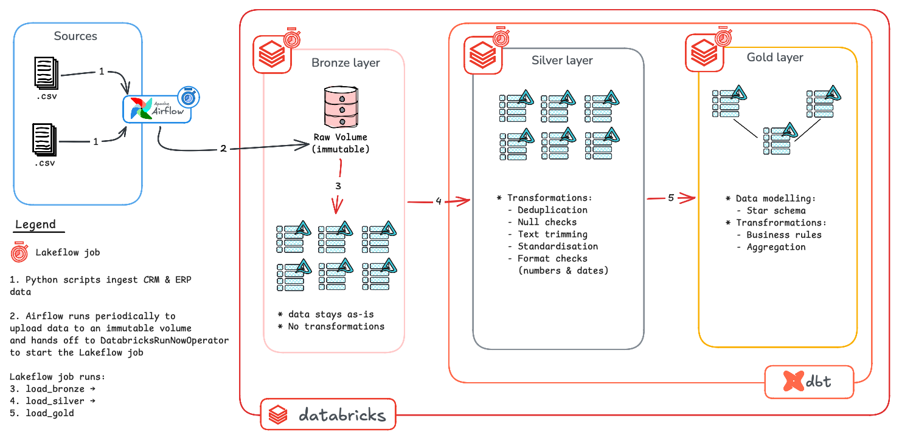

# Lakehouse Project (Databricks)

This project rebuilds the [SQL Server data warehouse](https://github.com/nasser-kiti/warehouse-project-local) as a lakehouse on Databricks, using the Medallion Architecture. Airflow lands source files in an immutable volume, and a Lakeflow job loads them into Bronze and runs the dbt transformations for Silver and Gold.

## Overview

- **Data Architecture**: a lakehouse on **Databricks** and Unity Catalog, organised into landing, Bronze, Silver and Gold layers.
- **Ingestion**: write-once, checksum-verified landing of source files, orchestrated by **Airflow**.
- **ELT**: raw data is loaded first, then transformed in the platform with **dbt**.
- **Orchestration**: Airflow handles getting data into the platform; a **Lakeflow** job (defined as code with Databricks Asset Bundles) runs everything inside it.
- **Data Quality**: integrity checks before Bronze, and dbt tests that gate each layer.

## Data Architecture



### Specifications

- **Data Sources**: two source systems (CRM and ERP) delivered as CSV files.
- **Raw data is never changed**: landed files are immutable; corrections arrive as new batches.
- **Reruns are safe**: every stage is idempotent, so retries and backfills never duplicate data.
- **Data Quality**: data quality issues are resolved in Silver, and tests stop bad data from reaching Gold.
- **Scope**: latest-state analytics; historisation is not required.

1. **Landing**: an Airflow task uploads the CSV files to a Unity Catalog volume, one write-once folder per source per ingest date, with a checksum manifest written last.
2. **Hand-off**: Airflow triggers the Lakeflow job by name, passing the ingest date, and waits for it to finish.
3. **Bronze**: the job verifies each manifest, then loads the files into Delta tables with `COPY INTO`, unchanged apart from ingestion metadata.
4. **Silver**: dbt deduplicates, trims, standardises and types the data. Tests must pass before Gold builds.
5. **Gold**: dbt models a star schema (views): point-in-time products, CRM-mastered customers.

---

## Data Pipeline

### Immutability

Raw data is protected in layers, from who can write to how storage behaves:

| Layer | Control | Status |
| ------- | --------- | -------- |
| 1. Access | Only the ingestion service principal can write to the volume; the volume is owned by a group, not a person | Planned (currently a personal account) |
| 2. Processing | The loader verifies every landed file against its manifest and fails on any discrepancy | ✅ Implemented (`verify_batch`) |
| 3. Bronze tables | `delta.appendOnly = true` on every Bronze table: `INSERT` and `COPY INTO` work; `UPDATE`, `DELETE` and row-changing `MERGE` are refused | ✅ Implemented (set at table creation in `load_bronze`) |
| 4. Storage | A bucket retention policy (S3 Object Lock, GCS retention, Azure immutable blobs) prevents changes or deletion for a set period | Requires an external volume; not available on managed storage |

Idempotency (safe reruns) and immutability (unchangeable raw data) are both separate guarantees needed by the pipeline.


### Landing (Ingestion)

- **Purpose**: move source files into the platform without changing them, and record what arrived.
- **Code**: `src/lakehouse/landing/load_volume.py`, run by the `land_files` task in `airflow/dags/lakehouse_ingest.py`.
- **Architectural decisions**: [Landing layer architectural decisions](assets/docs/arch_logic_landing.md) for details.

```bash
uv run python -m unittest discover tests
```

Tests use in-memory and temp-folder fakes, so they need no Databricks access.

### Bronze (Raw Tables)

- **Code**: `src/lakehouse/bronze/load_bronze.py`, run as the `load_bronze` wheel task in `resources/lakehouse_pipeline.job.yml`.
- **Architectural decisions**: [Bronze layer architectural decisions](assets/docs/arch_logic_bronze.md) for details.

**Idempotency scope** Each layer is idempotent within its own scope:

| Mechanism | Idempotent per | Same date again | Identical file on a new date |
|-----------|----------------|-----------------|------------------------------|
| Manifest + checksums (landing) | Ingest date | Skipped | Landed again (new folder) |
| `COPY INTO` (Bronze) | File path | 0 rows inserted | Loaded again (new path) |
| Key-based dedup (Silver) | Business key | No change | No change |

Verified by landing the same files for 2026-10-21 and 2026-10-22: Bronze doubled (`crm_cust_info`: 36,988 rows, 18,494 distinct `_row_hash`) while Silver stayed at 18,484 customers. Bronze faithfully records that the source sent the same content twice; Silver turns it into one correct current state.

Trade-off: with daily full-snapshot deliveries, Bronze grows by one full copy per day (cents per month at this volume). The planned fix, once the DAG runs on a schedule, is to skip files at landing whose checksum matches the previous batch and record them as `unchanged` in the manifest.

### Silver (Cleansing & Standardisation)

- **Code**: `dbt/models/silver/{crm,erp}/`, run as the `load_silver` dbt task (`dbt build --select source:bronze path:models/silver`) after `load_bronze`.
  `dbt build` runs each model's tests, so a failing Silver test stops the job before Gold.
- **Architectural decisions**: [Silver layer architectural decisions](assets/docs/arch_logic_silver.md)

| Model | Grain | Key rules | Rows |
|-------|-------|-----------|------|
| `crm_cust_info` | One row per customer | Rows without `cst_id` excluded (warn test on source); latest `cst_create_date` wins; names trimmed, codes mapped (`M` → `Married`/`Male`) | 18,484 |
| `crm_prd_info` | One row per product version | `category_id` / `product_key` split from `prd_key`; source end dates ignored (200 of 397 end before they start); `end_date` = next version's start − 1 day, latest version open | 397 |
| `crm_sales_details` | One row per order line | `yyyyMMdd` dates parsed, invalid or pre-1990 dates null (19); price made positive or derived from sales; `order_total` = quantity × price | 60,398 |
| `erp_cust_az12` | One row per customer | `NAS` prefix stripped so `customer_key` matches CRM; future birth dates (16 placeholders like 9999-11-20) set to null | 18,484 |
| `erp_loc_a101` | One row per customer | Hyphens stripped from the key; country codes mapped (`US`/`USA`, `DE`); blanks `'n/a'` | 18,484 |
| `erp_px_cat_g1v2` | One row per category | Trimmed; `maintenance` as a boolean | 37 |

**Tests**: `unique` + `not_null` on every grain key; `accepted_values` on every mapped column (a missing mapping fails the build instead of leaking a raw code); singular tests for business rules (one open product version, valid date ranges, positive amounts, order before ship before due, one row per order line, Silver-to-Bronze reconciliation); `relationships` between models at `warn` severity.

**Known warnings** (reported on every run, by design):
- 4 Bronze `crm_cust_info` rows without `cst_id`.
- 19 sales rows without a valid `order_date`.
- Product category `CO_PE` has no match in `erp_px_cat_g1v2`; Gold keeps those products with a left join and `'n/a'` category.

### Gold (Star Schema)

- **Code**: `dbt/models/gold/`, run as the `load_gold` dbt task (`dbt build --select path:models/gold`) after `load_silver`.
- **Architectural decisions**: [Gold layer architectural decisions](assets/docs/arch_logic_gold.md)

| Model | Grain | Key | Notes | Expected rows |
|-------|-------|-----|-------|---------------|
| `dim_customers` | One row per customer | `customer_sk = xxhash64(customer_id)` | CRM master; ERP birth date, country, and gender fallback | 18,484 |
| `dim_products` | One row per product version | `product_sk = xxhash64(product_id)` | `valid_from` / `valid_to` for point-in-time joins; unknown member `-1` | 398 (397 + unknown) |
| `fact_sales` | One row per order line | `order_number` + `product_sk` | Product version valid on the order date; 19 sales without a valid date use the unknown product | 60,398 |

**Known gap**: Gold views read Silver tables directly, so data that fails a Silver test is visible through Gold until fixed (the job fails and alerts).

---

### Useful Links

[Setup Instructions](assets/docs/setup.md)
[Troubleshooting](assets/docs/debug.md)